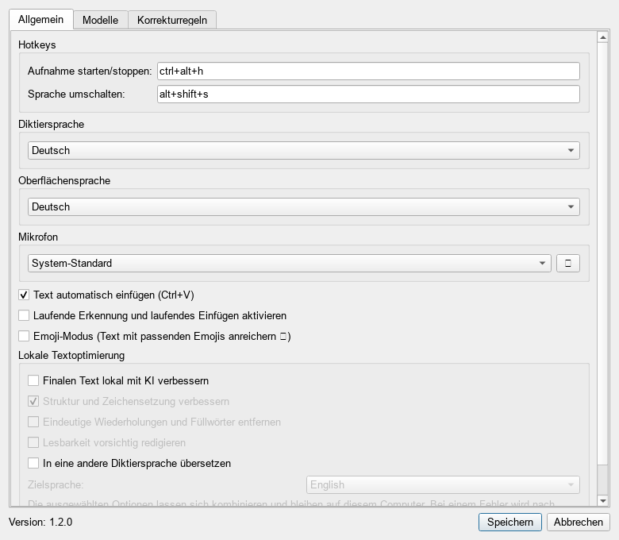
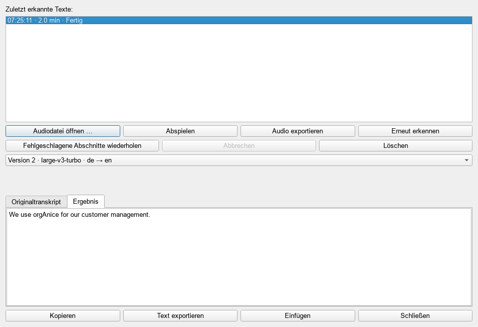
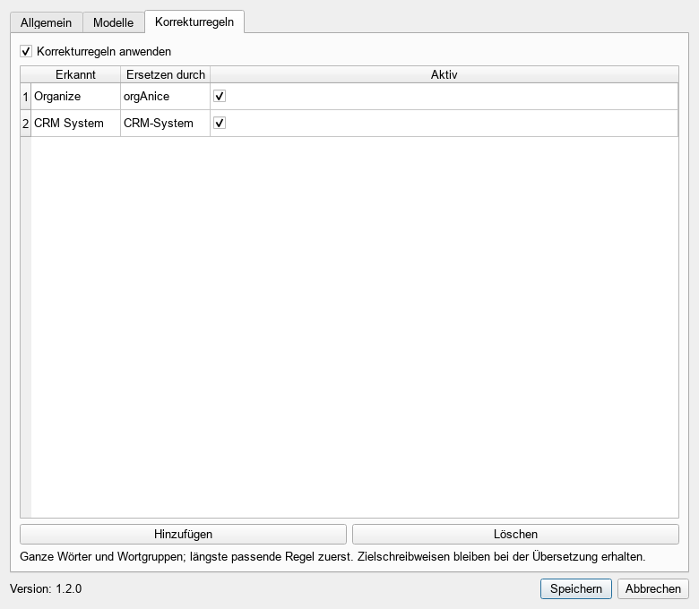
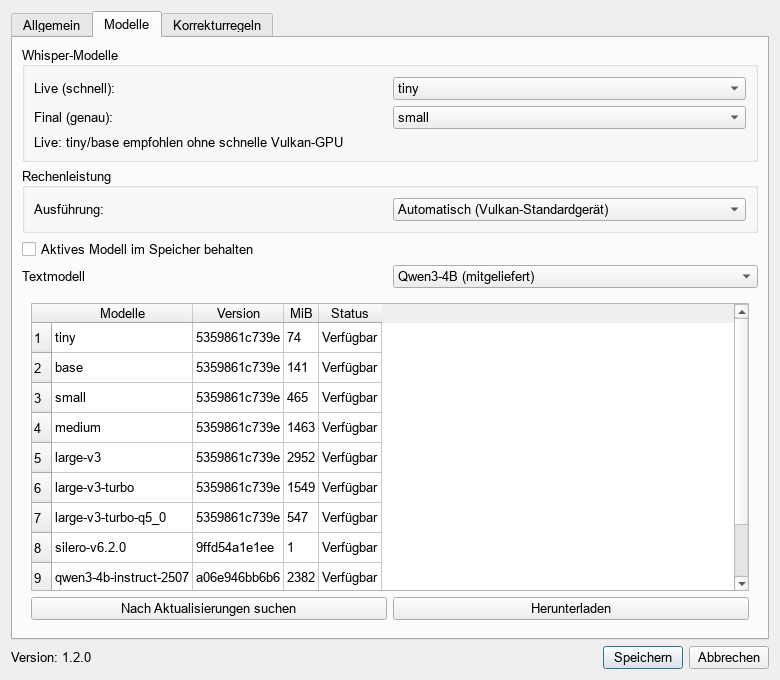
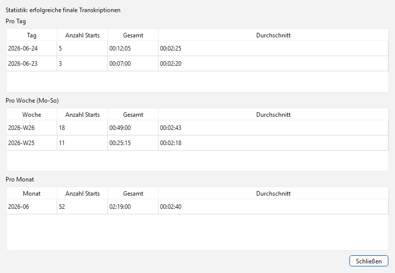

# WinWhisperPlus Benutzerhandbuch

Dieses Handbuch beschreibt die Bedienung von WinWhisperPlus Version 1.2.0. WinWhisperPlus ist ein Windows-Tool für lokale Spracherkennung mit Whisper. Die Aufnahme wird lokal verarbeitet; nach der Erkennung kann der Text automatisch in das aktive Eingabefeld eingefügt werden.

## Überblick

WinWhisperPlus läuft im Hintergrund und zeigt ein kleines Statusfenster sowie ein Symbol im Windows-Infobereich. Die wichtigsten Aufgaben sind:

- Sprache aufnehmen und in Text umwandeln.
- Den erkannten Text automatisch per Zwischenablage einfügen.
- Zwischen Deutsch, Polnisch, Englisch, Französisch und Niederländisch als Diktiersprache wechseln.
- Hotkeys, Mikrofon, Oberflächensprache und Whisper-Modelle konfigurieren.
- Den finalen Text bei Bedarf vollständig lokal mit KI strukturieren und bereinigen.
- Vorherige Transkriptionen aus dem Verlauf erneut einfügen.
- Nutzungsstatistiken für erfolgreiche finale Transkriptionen anzeigen.

## Installation und erster Start

Verwenden Sie das bereitgestellte Setup. Nach der Installation starten Sie `WinWhisperPlus.exe`. Beim ersten Start kann Whisper das ausgewählte Modell herunterladen; dafür ist einmalig Internetzugriff erforderlich. Danach liegen Modell, Einstellungen und Statistikdaten lokal.

Nach dem Start erscheint das kleine Statusfenster. Die Anwendung bleibt aktiv, auch wenn kein großes Hauptfenster geöffnet ist.


## Statusfenster und Menü

Das Statusfenster zeigt den aktuellen Zustand der Anwendung:

- `Bereit`: WinWhisperPlus wartet auf eine Aufnahme.
- `Aufnahme läuft`: Das Mikrofon wird aufgenommen.
- `Verarbeitung läuft`: Die Aufnahme wird transkribiert.
- `Text eingefügt`: Der erkannte Text wurde eingefügt.
- `Initialisierung` oder `Modelle laden...`: Die App oder Whisper-Modelle werden vorbereitet.

Im unteren Bereich des Statusfensters steht der Aufnahme-Hotkey. Mit Rechtsklick auf das Statusfenster oder über das Tray-Symbol öffnen Sie das Menü mit diesen Einträgen:

- `Aufnahme starten` oder `Aufnahme stoppen`
- `Verlauf...`
- `Statistiken...`
- `Einstellungen...`
- `Beenden`


## Aufnahme starten und stoppen

Standardmäßig starten oder stoppen Sie eine Aufnahme mit `Ctrl+Alt+H`. Alternativ verwenden Sie den Menüpunkt `Aufnahme starten` im Kontextmenü. Während der Aufnahme spricht man den gewünschten Text ein; beim Stoppen wird die Aufnahme final transkribiert.

Wenn `Text automatisch einfügen` aktiviert ist, setzt WinWhisperPlus den erkannten Text per `Ctrl+V` in das aktuell aktive Eingabefeld ein. Klicken Sie daher vor dem Stoppen oder vor dem finalen Einfügen in das Zielprogramm, zum Beispiel Editor, E-Mail, Browser oder Fachanwendung.

Der Hotkey `Alt+Shift+S` schaltet die Diktiersprache in der Reihenfolge Deutsch, Polnisch, Englisch, Französisch, Niederländisch um. Nach dem Umschalten zeigt das Statusfenster kurz die neue Sprache an.

## Einstellungen

Öffnen Sie `Einstellungen...`, um das Verhalten der Anwendung anzupassen.



Die wichtigsten Optionen:

- `Aufnahme starten/stoppen`: Hotkey für die Aufnahme. Klicken Sie in das Feld und drücken Sie die gewünschte Tastenkombination.
- `Sprache umschalten`: Hotkey für den Wechsel der Diktiersprache.
- `Diktiersprache`: Sprache, in der Whisper die Aufnahme interpretieren soll.
- `Oberflächensprache`: Sprache der Benutzeroberfläche. Verfügbar sind Deutsch, Polnisch und Englisch.
- `Mikrofon`: Eingabegerät. `System-Standard` verwendet das Windows-Standardmikrofon.
- `Live (schnell)`: Modell für laufende Live-Erkennung. `tiny` und `base` sind für kurze Latenz vorgesehen.
- `Final (genau)`: Modell für die abschließende Transkription. Größere Modelle sind genauer, brauchen aber mehr Zeit und Leistung.
- `Text automatisch einfügen`: Fügt erkannte Texte automatisch in das aktive Eingabefeld ein.
- `Laufende Erkennung und laufendes Einfügen aktivieren`: Fügt stabile Zwischenergebnisse während der Aufnahme ein.
- `Emoji-Modus`: Ergänzt bekannte Schlüsselwörter im erkannten Text mit passenden Emojis.
- `Lokale Textoptimierung`: Ist standardmäßig ausgeschaltet. Wenn sie aktiviert ist, verarbeitet das mitgelieferte Qwen3-Modell nur die finale Transkription auf diesem Computer. Die Optionen lassen sich frei kombinieren:
  - `Struktur und Zeichensetzung verbessern`: ergänzt Satzzeichen, sinnvolle Absätze und bei Bedarf einfache Listen.
  - `Eindeutige Wiederholungen und Füllwörter entfernen`: bereinigt nur klar überflüssige Teile.
  - `Lesbarkeit vorsichtig redigieren`: formuliert den Inhalt behutsam klarer und knapper.
  - `In eine andere Diktiersprache übersetzen`: übersetzt den Endtext wahlweise nach Deutsch, Polnisch, Englisch, Französisch oder Niederländisch. Die Übersetzung bleibt lokal und wird übersprungen, wenn Quell- und Zielsprache gleich sind.

Die Ausgabe bleibt Klartext mit Absätzen und `-`-Aufzählungen. Namen, Zahlen, Fakten und unklare Textstellen dürfen nicht erfunden oder ergänzt werden. Übersetzung ist unabhängig von Formatierung und Bereinigung auswählbar. Bei Fehlern bleibt das Originaltranskript im Verlauf verfügbar. Eine fehlgeschlagene Übersetzung wird ausdrücklich gekennzeichnet und nicht automatisch als fertiges Ergebnis eingefügt.

Speichern übernimmt die Einstellungen sofort und registriert die Hotkeys neu.

## Live-Erkennung

Die Live-Erkennung ist optional. Wenn sie aktiviert ist, transkribiert WinWhisperPlus während der laufenden Aufnahme überlappende Audiostücke und fügt stabile Zwischenergebnisse ein. Beim Stoppen ersetzt die finale Transkription den Live-Textblock durch das endgültige Ergebnis.

Ist die lokale Textoptimierung aktiv, läuft sie erst nach dieser finalen Transkription. Der vorläufige Live-Text wird anschließend durch den optimierten Endtext ersetzt.

Für Live-Erkennung ohne schnelle GPU sind kleine Modelle sinnvoll. Beginnen Sie mit `tiny`; wenn die Qualität nicht reicht, testen Sie `base`.

## Verlauf

Der Verlauf zeigt Aufnahmen und importierte Audios der aktuellen Sitzung, einschließlich fehlgeschlagener Erkennungen. Der neueste Eintrag steht oben. Wählen Sie eine Aufnahme und eine Ergebnisversion. Originaltranskript und Ergebnis stehen in getrennten Registern zur Verfügung. Mit `Kopieren`, `Text exportieren` oder `Einfügen` verwenden Sie den Text des aktuell geöffneten Registers.



Mit `Abspielen` hören Sie das Audio an. `Audio exportieren` speichert eine dauerhafte WAV-Datei außerhalb des Sitzungsspeichers. `Erneut erkennen` bietet Modell, Quellsprache und optionale Zielsprache zur Auswahl und legt eine weitere Ergebnisversion an. Der bisherige Text bleibt erhalten. Neu berechnete Ergebnisse werden zunächst angezeigt, ohne bereits eingefügten Text in anderen Anwendungen zu verändern.

Während der Verarbeitung können Sie `Abbrechen` wählen. `Fehlgeschlagene Abschnitte wiederholen` verwendet die erfolgreichen Abschnitte desselben Auftrags weiter. Mit `Löschen` entfernen Sie eine abgeschlossene Aufnahme aus dem Verlauf. Beim regulären Beenden werden sämtliche Sitzungsaudios gelöscht. Nach einem Absturz werden verwaiste Sitzungen beim nächsten Start bereinigt; Audios anderer laufender Instanzen bleiben erhalten. Exportieren Sie benötigte Aufnahmen vor dem Beenden.

## Korrekturregeln

Öffnen Sie `Einstellungen` und das Register `Korrekturregeln`. Mit `Hinzufügen` legen Sie eine Zeile an. Tragen Sie beispielsweise unter `Erkannt` den Text `Organize` und unter `Ersetzen durch` die Schreibweise `orgAnice` ein. Das Häkchen `Aktiv` schaltet die einzelne Regel ein oder aus; `Korrekturregeln anwenden` steuert alle Regeln unabhängig von der Textoptimierung.



Die Suche ignoriert Groß-/Kleinschreibung und erfasst vollständige Wörter oder Wortgruppen. Bei überlappenden Regeln gewinnt die längste passende Wortgruppe. Ersetzungen lösen keine weiteren Ersetzungen aus. Eine leere Ersatzschreibweise entfernt den Treffer; ein leerer Suchtext oder doppelte Suchtexte sind nicht zulässig. `Speichern` übernimmt die Regeln dauerhaft und atomisch, `Abbrechen` verwirft Änderungen. Speicherfehler werden angezeigt. Die vorläufige Liveanzeige wird noch nicht korrigiert; Korrekturen greifen im finalen Text.

## Audiodateien öffnen und übersetzen

Wählen Sie im Traymenü oder Verlauf `Audiodatei öffnen …`. Unterstützt werden WAV, MP3, M4A und FLAC. Wählen Sie die Quellsprache oder automatische Spracherkennung, ein Erkennungsmodell und optional eine Zielsprache. Deutsch, Polnisch, Englisch, Französisch und Niederländisch stehen als Zielsprachen zur Verfügung. Die Konvertierung und Erkennung erfolgen lokal; die Originaldatei bleibt unverändert.

Der Auftrag erscheint mit Fortschritt im Verlauf. Originaltranskript und Ergebnis lassen sich getrennt anzeigen, kopieren und als UTF-8-Text exportieren. Dateiimporte fügen niemals automatisch Text in ein fremdes Programm ein und interpretieren ein gesprochenes `Enter` als normalen Text.

## Lange Aufnahmen

Mikrofonaufnahmen werden fortlaufend auf die Festplatte geschrieben. Die Erkennung verarbeitet Abschnitte von höchstens 30 Sekunden mit einer Sekunde Überlappung und bevorzugt ruhige Schnittstellen. Silero erkennt Sprachaktivität. Doppelte Erkennung wird nur im zeitlich überlappenden Bereich entfernt. Auch der letzte kurze Abschnitt wird verarbeitet.

Textbearbeitung und Übersetzung werden an Satz- oder Absatzgrenzen aufgeteilt und gegen das Tokenbudget des tatsächlich verwendeten Modells geprüft. Abgeschnittene Antworten werden in kleineren Abschnitten erneut versucht. Wiederholungsschleifen werden markiert und einmal ohne vorherigen Kontext erneut erkannt; bei fortbestehendem Fehler steht der Abschnitt zur erneuten Verarbeitung bereit. Das Rohtranskript bleibt zur Diagnose erhalten.

## Modelle verwalten

Im Register `Modelle` wählen Sie Live- und finales Erkennungsmodell sowie das Textmodell getrennt aus. `large` bezeichnet weiterhin `large-v3`. Turbo-Varianten und alternative Qwen-Modelle sind zusätzliche Vergleichskandidaten; ein neueres Modell garantiert nicht automatisch bessere Ergebnisse für Ihre Aufnahmen.



`Nach Aktualisierungen suchen` prüft den von WinWhisperPlus veröffentlichten Modellkatalog. Neue Modelle und neue Revisionen installierter Modelle werden getrennt angezeigt. `Herunterladen` lädt die ausgewählte feste Revision und prüft Größe und SHA-256. Ein Abbruch oder fehlerhafter Download ersetzt kein vorhandenes Modell. Bei noch ungeprüften lokalen Dateien zeigt die Tabelle `Prüfung erforderlich`. Bereits heruntergeladene Modelle können offline verwendet werden.

Der mitgelieferte Qwen3-4B bleibt auswählbar. Laufzeitupdates werden mit Programmupdates ausgeliefert; inkompatible Modelle zeigen die erforderliche Programmversion an. Falls der neue Modellkatalog noch nicht als Release-Anhang veröffentlicht wurde, kann die Onlineprüfung mit HTTP 404 scheitern. Der mitgelieferte Katalog bleibt nutzbar.

## Statistiken

Die Statistik zeigt erfolgreiche finale Transkriptionen nach Tag, Woche und Monat. Angezeigt werden Anzahl Starts, Gesamtdauer und Durchschnittsdauer.



Die Werte helfen dabei, die Nutzung einzuschätzen und zu erkennen, ob viele kurze oder wenige lange Diktate verarbeitet wurden.

## Speicherorte

WinWhisperPlus speichert Benutzerdaten unter:

```text
%APPDATA%\WinWhisperPlus
```

Wichtige Dateien:

- `settings.json`: Hotkeys, Sprachen, Mikrofon, Modelle und weitere Einstellungen.
- `statistics.json`: Statistikdaten erfolgreicher finaler Transkriptionen.
- `winwhisperplus.log`: Laufzeitmeldungen und Fehlerhinweise.

Modelle und Prüfnachweise liegen unter `%LOCALAPPDATA%\WinWhisperPlus\models`. Temporäre Sitzungsaudios liegen unter `%LOCALAPPDATA%\WinWhisperPlus\sessions`. Exportierte Audio- und Textdateien werden an Ihrem gewählten Speicherort abgelegt und nicht automatisch gelöscht.

Eine alte Konfiguration aus `%APPDATA%\MyWhisper\settings.json` kann beim Start übernommen werden, wenn noch keine neue WinWhisperPlus-Konfiguration existiert.

## Fehlerbehebung

### Das Modell wird beim ersten Start geladen

Beim ersten Einsatz eines Whisper-Modells kann ein Download notwendig sein. Warten Sie, bis die Initialisierung abgeschlossen ist. Wenn der Download blockiert wird, prüfen Sie Internetzugang, Proxy, Virenschutz und Firewall.

Das Standard-Textmodell wird mit dem Installer ausgeliefert. Alternative Textmodelle können über die Modellverwaltung heruntergeladen werden und benötigen mehrere GB Speicherplatz. Alle Modelle laufen ausschließlich lokal; erkannter Text wird nicht an einen Cloud-Dienst übertragen.

### Das Mikrofon fehlt in der Liste

Öffnen Sie die Einstellungen und klicken Sie auf die Aktualisieren-Schaltfläche neben der Mikrofonliste. Prüfen Sie außerdem, ob Windows das Mikrofon erkennt und ob die Datenschutzfreigabe für Mikrofonzugriff aktiv ist.

### Der Hotkey funktioniert nicht

Ein Hotkey kann von einer anderen Anwendung belegt sein oder unter Windows nicht global registriert werden. Wählen Sie in den Einstellungen eine andere Kombination und speichern Sie erneut.

### Der Text wird nicht eingefügt

Klicken Sie vor dem Stoppen der Aufnahme in das Ziel-Eingabefeld. Wenn das Zielprogramm Einfügen per Zwischenablage blockiert, deaktivieren Sie testweise `Text automatisch einfügen` und kopieren Sie den Text aus dem Verlauf.

### Die Transkription schlägt fehl

Öffnen Sie `%APPDATA%\WinWhisperPlus\winwhisperplus.log` und prüfen Sie die letzten Fehlermeldungen. Typische Ursachen sind ein nicht verfügbares Mikrofon, ein fehlgeschlagener Modell-Download oder zu wenig Speicher für ein großes Whisper-Modell.

### Die Erkennung ist zu langsam

Wählen Sie ein kleineres finales Modell, zum Beispiel `base` oder `small`. Für Live-Erkennung verwenden Sie `tiny` oder `base`. Eine Vulkan-fähige GPU kann die Verarbeitung deutlich beschleunigen, ist aber für die Grundfunktion nicht zwingend erforderlich.

### Die Textoptimierung schlägt fehl

Der Originaltext bleibt im Verlauf erhalten. Fehlgeschlagene Übersetzungen werden ausdrücklich gekennzeichnet. Prüfen Sie `%APPDATA%\WinWhisperPlus\winwhisperplus.log` und wiederholen Sie die Verarbeitung bei Bedarf. Häufige Ursachen sind zu wenig freier RAM/Grafikspeicher, ein beschädigtes Release-Paket oder ein nicht verfügbarer Vulkan-Treiber. Modelldateien werden vor der Verwendung per SHA-256 geprüft.
